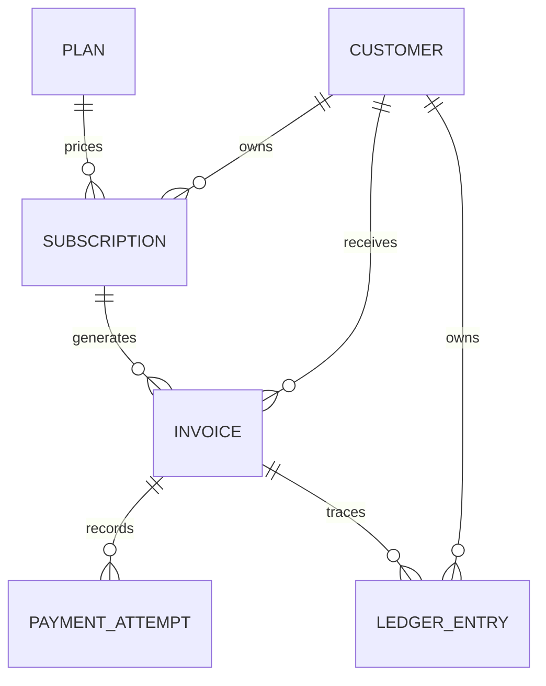

# SubLedger — Low-Level Design

## Scope and assumptions
SubLedger is a simplified billing backend, not a payment processor. Payment attempts are recorded from a simulated/provider-originated result; no real card data or gateway integration is implemented. Amounts use `DecimalField`, never binary floating point. Currency is stored as an ISO-like three-character code. Billing periods are approximated as 30/90/365 days for monthly/quarterly/yearly cycles; production billing should use calendar-aware period arithmetic.

## Entity relationships

## Models
- **Plan**: name, description, price, currency, billing cycle, active flag, timestamps.
- **Customer**: unique email, name, active/inactive status, timestamps.
- **Subscription**: customer, plan, active/cancelled/expired status, start/end/cancelled dates. A conditional database uniqueness constraint prevents duplicate active customer-plan pairs.
- **Invoice**: subscription, customer, amount due and paid, currency, status, billing period, due date. `amount_due` snapshots the plan price at generation time.
- **PaymentAttempt**: invoice, amount, currency, succeeded/failed result, unique provider reference, failure reason.
- **LedgerEntry**: customer, optional invoice, event type, amount/currency, unique reference, description, timestamp. Append-only by model-level update/delete guard; production should additionally enforce immutability with database permissions/triggers and restrict admin access.

## Layer responsibilities
| Layer | Responsibility |
|---|---|
| URLs / ViewSets | HTTP routing, request/response, status codes; no billing calculations |
| Serializers | Input validation and output representation |
| Services | Business rules, transaction boundaries, orchestration |
| Models | Persistence schema, relationships, database constraints |
| Database | Referential integrity, uniqueness and transaction isolation |

## Service and repository pattern
Django ORM query operations are kept behind service orchestration for the core workflows. Django model managers/querysets serve as the repository boundary in this compact assignment implementation; dedicated repository classes can be introduced if the application grows or alternate persistence is required. Services are injected conceptually through explicit service methods rather than route-level billing logic.

## Business rule ownership
- Plan price > 0: `PlanSerializer`.
- Customer email unique: database unique constraint; normalized to lowercase in serializer.
- Inactive plan cannot be subscribed to; customer must be active: `SubscriptionService`.
- No duplicate active subscription for same customer and plan: `SubscriptionService` plus conditional unique constraint.
- Invoice amount due is current plan price at generation: `InvoiceService` snapshots price into invoice.
- Successful payment cannot exceed remaining balance: `PaymentService` under `transaction.atomic()` and `select_for_update()`.
- Successful payment updates amount/status; failed payment does not change amount paid: `PaymentService`.
- Ledger entries are traceable and append-only: unique `reference_id`, creation inside workflow transaction, model update/delete guards.

## Invoice generation flow
1. Route validates `subscription_id`.
2. `InvoiceService` fetches and locks subscription, including customer and plan.
3. Reject missing or non-active subscription.
4. Snapshot current plan price and currency, calculate period and due date.
5. Create issued invoice.
6. Append `invoice_created` ledger event in the same transaction.
7. Return invoice response.

## Payment recording flow
1. Route validates amount, currency, status, provider reference and optional failure reason.
2. `PaymentService` locks invoice and checks it exists, is payable, and currency matches.
3. Successful payment must not exceed unpaid balance.
4. Create payment attempt with unique provider reference.
5. On success, increase amount paid and set `partially_paid` or `paid`; on failure, leave invoice balance unchanged.
6. Append success/failure ledger event in the same transaction.
7. Return payment attempt and updated invoice.

## API list
- `GET/POST /api/plans/`, `GET/PATCH/DELETE /api/plans/{id}/`, `POST /api/plans/{id}/deactivate/`
- `GET/POST /api/customers/`, `GET/PATCH/DELETE /api/customers/{id}/`, `GET /api/customers/{id}/ledger/`
- `GET/POST /api/subscriptions/`, `GET/PATCH/DELETE /api/subscriptions/{id}/`, `POST /api/subscriptions/{id}/cancel/`
- `GET/POST /api/invoices/`, `GET /api/invoices/{id}/`, `POST /api/invoices/generate/`, `POST /api/invoices/{id}/payments/`, `GET /api/invoices/{id}/payment_attempts/`
- `GET /api/payment-attempts/`, `GET /api/payment-attempts/{id}/`
- `GET /api/ledger-entries/`, `GET /api/ledger-entries/{id}/`

## Production limitations
Authentication/authorization, rate limiting, idempotency keys beyond provider-reference uniqueness, external payment gateway integration, retries/outbox delivery, audit logging, calendar-accurate billing, and database-level ledger immutability are outside this simplified assignment scope. Do not expose open permissions as-is in production.
